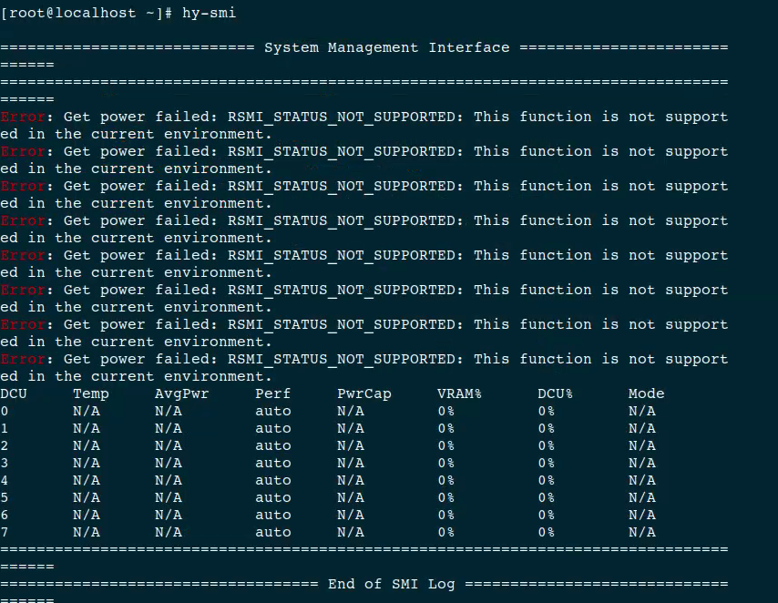
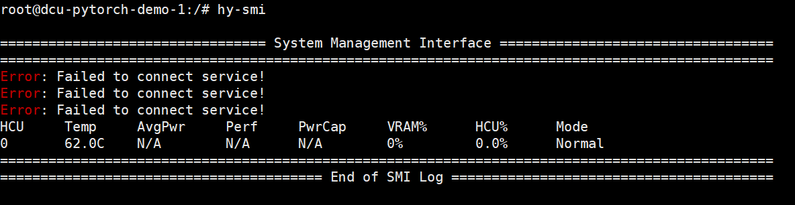

### 1. 容器中直接运行hy-smi报错，运行结果出现"N/A"或"RSMI_NOT_SUPPORTED"报错



解决办法：执行source /opt/hyhal/env.sh后执行hy-smi；或执行/opt/hyhal/bin/hy-smi.

### 2. 部署HCU-Device-Plugin后工作负载中申请HCU资源，任务所在Po容器中不存在/opt/hyhal目录

解决办法：v2.1.0及之后版本的HCU-Device-Plugin会自动挂载/opt/hyhal目录到HCU申请Pod，V2.1.0之前版本在申请HCU的yaml中需要手动挂载该目录。

### 3. HCU-Exporter部署后指标中K8s相关label始终为空

解决办法：

检查K8s集群中是否存在使用HCU设备的工作负载；

检查K8s节点/var/lib/kubelet是否存为kubelet实际工作目录;

检查HCU-Exporter容器中"KUBERNETES_SERVICE_HOST"与"KUBERNETES_SERVICE_PORT"两个环境变量是否与k8s集群实际配置一致。

### 4. 6.3.13版本驱动安装后，通过HCU-Device-Plugin资源声明启动的containerd容器中运行hy-smi报错"Failed to connect service!"



解决办法：此为6.3.13驱动的一个Bug，升级或者降级驱动版本可以解决该问题。若无法升级或者降级驱动，工作负载启动时指定网络类型为hostnetwork可以暂时解决该问题。

### 5. 6.3.8版本驱动命令行hy-smi运行忽然变慢

解决办法：使用hy-smi --showdriverversion命令查看驱动版本，6.3.8版本存在通信问题，将驱动升级为最新版本可解决该问题。

### 6. vHCU-Scheduler组件部署后申请vHCU失败

（1）检查HCU-Device-Plugin、vhcu-admission-webhok、vhcu-scheduler这三个组件对应的pod状态是否正常，device-plugin节点是否包含标签 hcu=on；

（2）如果出现报错信息

```
Internal error occurred: failed calling webhook "hcu.hygon.com": Post https://admission-webhook-hcu-svc.kube-system.svc:443/mutate?timeout=10s: service "admission-webhook-hcu-svc" not found
```

a.首先检查vhcu-admission-webhook是否与所在宿主机共用网络，宿主机443端口是否被占用；

b.删除如下资源后，重新部署vhcu-admission-webhook组件

```
kubectl delete secrets -n kube-system   admission-webhook-hcu-certs
kubectl delete mutatingwebhookconfigurations mutating-webhook-hcu-cfg
```

（3）v2.1.0及之前版本的插件还需要进行如下排查：

a.检查k8s-vhcu-scheduler的版本是否和k8s集群版本是否匹配；

b.检查k8s-vhcu-secheuler是否调度到非HCU节点；

c.低版本k8s需要把scheduler的部署yaml中这个kubescheduler.config.k8s.io/v1改成kubescheduler.config.k8s.io/v1beta2